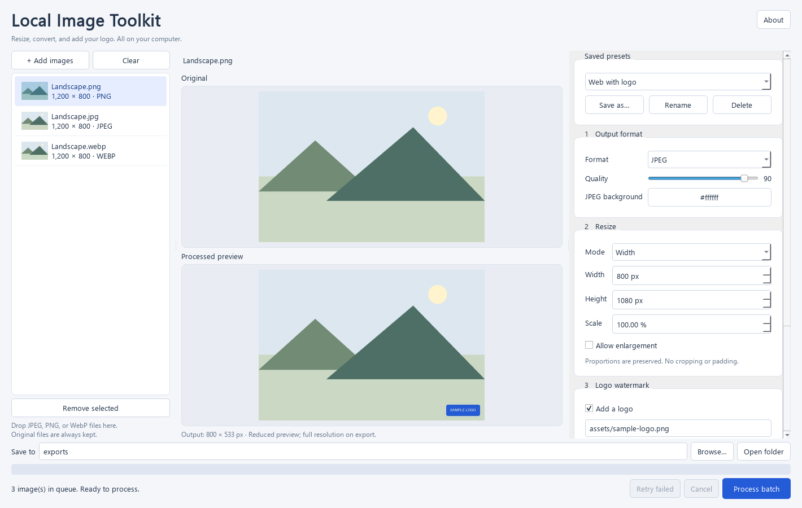

# Local Image Toolkit

Resize, convert, and add a logo to images on your Windows computer. Work with one image
or a mixed batch of JPEG, PNG, and WebP files, with a preview before exporting.

**Created by [Ibrahim Samir](https://github.com/IbrahimS-1101).** Free and open source under
the [MIT license](LICENSE). No uploads, accounts, subscriptions, or runtime internet connection.



## Get started

Windows portable builds are distributed through [GitHub Releases](https://github.com/IbrahimS-1101/local-image-toolkit/releases).
If a public build is not available yet, use the source setup below.

1. Download and extract the entire Windows portable ZIP.
2. Double-click **Local Image Toolkit.exe**. No Python installation is needed for the portable build.
3. Drag images into the window, or click **Add images**.
4. Choose your settings and select an image to inspect the preview.
5. Choose an output folder, then click **Process batch**.

Keep the `_internal` folder beside the executable. Originals and existing output files are
never overwritten: exports use `name_processed.ext`, with numeric suffixes when needed.

## Features

| Task | Options |
| --- | --- |
| Convert | JPEG, PNG, and WebP; keep each image's original format or choose one format for the batch |
| Resize | Fit within a box, set width or height, scale by percentage, or explicitly stretch to exact dimensions |
| Add a logo | Four corners or center, with adjustable size, opacity, and margins |
| Batch export | Progress, cancellation between files, individual errors, and retry |
| Reuse settings | Save, load, rename, and delete presets |

Proportions are preserved unless you choose exact stretching. Enlargement is disabled by
default. JPEG/WebP quality is adjustable; PNG export is lossless. Transparent PNG/WebP
images retain their transparency, while JPEG uses your chosen background color.

Photo orientation is corrected, valid embedded color profiles are converted to sRGB, and
EXIF/GPS/text metadata is removed. Invalid profiles produce an error. Unprofiled images are
treated as sRGB after mode conversion.

## Current limits

- Windows x64: **Windows 10 version 1809 (build 17763) or later, or Windows 11**.
  This is the [Qt 6.11 platform minimum](https://doc.qt.io/qt-6.11/supported-platforms.html).
  Tested successfully on Windows 11; clean-machine Windows 10 validation is still pending.
  Windows 10 version 1607 (build 14393) is below the minimum and failed to launch in a fresh VM.
- Still JPEG, PNG, and WebP images only. Animated images and other formats are rejected.
- 50-megapixel limit for each input, logo, and output.
- One set of settings per batch. No per-image overrides, cropping, text watermarks, HEIC/RAW,
  animation editing, or target-file-size compression.
- Previews use a smaller image; actual output sizes are reported after saving.
- The executable is unsigned. Windows may show its standard unfamiliar-app warning.

The last output folder and presets are stored in
`%LOCALAPPDATA%\LocalImageToolkit\preferences.json`. Image contents and the queue are not saved there.
See [testing and compatibility](TESTING.md) for checks performed and remaining verification limits.

## Run from source

Use 64-bit Python 3.12 on Windows. From the repository root:

```powershell
python -m venv .venv
.venv\Scripts\python.exe -m pip install -r requirements-dev.txt
.venv\Scripts\python.exe main.py
```

Run the test suite:

```powershell
.venv\Scripts\python.exe -m pytest tests -q
```

The image engine is independent of the UI. The desktop app runs batches sequentially in
the background, keeps settings fixed for each batch, and discards stale preview results.
See [TESTING.md](TESTING.md) for the desktop acceptance harness.

## Build a portable Windows ZIP

After installing the development dependencies:

```powershell
.venv\Scripts\python.exe build_release.py --output .\dist\v1.0.0
```

The build downloads pinned Qt/PySide corresponding-source archives, checks their SHA-256
hashes, and collects dependency licenses into the ignored `.release-materials/` folder.
It bundles those materials with the executable and public application source. The desktop
app itself does not download anything.

With materials cached, add `--offline` to prevent downloads. To reuse an extracted portable
release's materials, pass `--materials` pointing to its app folder. Choose a fresh output
folder for each build; packaging refuses to replace an existing app directory.

The initial portable release was built with Python 3.12.4.

## Contribute

Bug reports, focused improvements, and suggestions are welcome. See the
[contribution guide](CONTRIBUTING.md) and [release notes](RELEASE_NOTES.md).

## License and credits

Copyright (c) 2026 Ibrahim Samir. Application code is licensed under [MIT](LICENSE).
PySide6/Qt, Pillow, Python, and other bundled components retain their own licenses;
see [third-party notices](THIRD_PARTY_NOTICES.md). Contributor acknowledgments will be added
as contributions are accepted.
